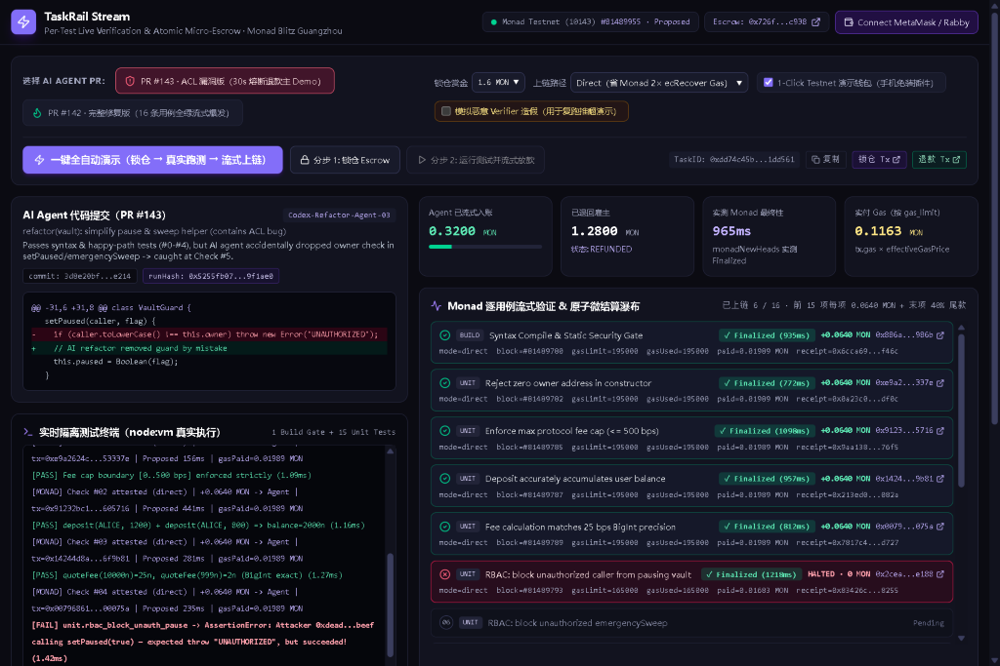

# TaskRail Stream

> **Per-Test-Case Live Code Verification & Atomic Micro-Escrow on Monad Testnet**  
> Built from scratch at **Monad Blitz@广州** (`eventId=18`).



## 已部署公网应用与真实链上记录（Monad Testnet · Chain ID `10143`）

- **公网 Live Demo（Vercel）**：https://monad-blitz-eight.vercel.app
- **核心合约 `TaskRailEscrow`（已通过 Monadscan & MonadVision 双浏览器源码验证）**：[`0x726f083ae7a6f9a1c2422dcd87c794fe8c88c938`](https://testnet.monadscan.com/address/0x726f083ae7a6f9a1c2422dcd87c794fe8c88c938)
- **部署交易**：[`0x78a575a65a3eb64a42e73b0e207134e00c724985d7f20d4a06938d413778afca`](https://testnet.monadscan.com/tx/0x78a575a65a3eb64a42e73b0e207134e00c724985d7f20d4a06938d413778afca)（Block `#81483116`）
- **公网实测 1｜PR #142 零漏洞 · 16 笔 Monad 并发齐射（Pipeline Burst）**：
  - 16 笔真实测试验证与微打款 **全部打包进同 1 个 Monad 区块（`#81498925`）**，VM `52.57ms` / Broadcast `405ms` / Confirmed `1643ms`，Agent 精准入账 `1.6000 MON`（含第 16 项 `+0.6400 MON` 尾款，`0 wei` 尘埃）
  - `createTask (1.6 MON)`：[`0xd7bf6fde...`](https://testnet.monadscan.com/tx/0xd7bf6fde228f539aa75f49b635a6aa0b5e401a6cc04b3fa57aa89c2fa590b65c)（`407ms`，Block `#81498921`）
  - Check #00 ～ Check #15（Block `#81498925`）：首笔 [`0xbe008a46...`](https://testnet.monadscan.com/tx/0xbe008a464fc07b7afce450d6dbbb6fcbc60a226bf1c7fff9de84132c1a338fb2) ～ 末笔 [`0x762e6046...`](https://testnet.monadscan.com/tx/0x762e604628277f9c402020fa7d432e94c14bde4aa72dcccb820f07f210015d10)
- **公网实测 2｜Live Bug Mutator 动态漏洞注入（`FEE ×10 BUG`）→ Check #04 精准熔断 & 365ms 退款**：
  - 现场勾选 `破坏手续费 BigInt 分母精度` 动态重写源码并重算 `runHash`，沙盒实跑通过前 4 项（`+0.2560 MON`），Check #04 抛出 `AssertionError (expected=25, actual=250)` 当场触发链上 `HALTED`，一键退回 `1.3440 MON`
  - `createTask (1.6 MON)`：[`0xe0af0027...`](https://testnet.monadscan.com/tx/0xe0af00279d511ed8b83bc3940b169f5f2bdb0bc8933ad7376e67f18a36cef119)（`360ms`）
  - `Check #04 (FEE ×10 FAIL -> HALTED)`：[`0x90244cf6...`](https://testnet.monadscan.com/tx/0x90244cf6cac570d96c6a906463f578882d50137f99c4a3d2d563ffee5d537ad4)（Block `#81499024`，Finalized `1087ms`）
  - `refundRemaining (1.3440 MON)`：[`0x2225c8a9...`](https://testnet.monadscan.com/tx/0x2225c8a92806146740de033b96b6b0b2c20a6dc01e392ba981a7a5c7c36df5ad)（`365ms`）
- **公网实测 3｜PR #143 越权漏洞版 + EIP-712 无许可中继 + 同 `runHash` 链上争议冻结**：
  - PR #143 Check #05 ACL 熔断：[`0x2cea99c0...`](https://testnet.monadscan.com/tx/0x2cea99c0270b18c4756210de15309cc3aeee33d00e933ed299dd383f878de188) → 退款 `1.28 MON`：[`0xc73bd141...`](https://testnet.monadscan.com/tx/0xc73bd141200d8743591a0aeb8218f6ede8ca0e395c98b57982614b0b68146c0f)（`284ms`）
  - EIP-712 链上无许可中继验签：[`0x7326f6e3...`](https://testnet.monadscan.com/tx/0x7326f6e339593e1b5e6046b3afde32390305f2956d7564d581db9ce6063a56fb)（实付 `0.01617 MON`）
  - 同 `runHash` 链上争议冻结 (`disputeCheck`) + 退款：[`0x28e48e42...`](https://testnet.monadscan.com/tx/0x28e48e423c3484ca3d9dd5366bdab2052ce966dd983bfdb21de0700910acf646) → [`0x18720005...`](https://testnet.monadscan.com/tx/0x1872000530dda3d9d90e56bee697bef7ad4defab0998c97f98b3f5881bbf8557)

## 一句话说明

雇主在 Monad 测试网锁定 AI 代码交付赏金，演示验证器逐条运行构建检查与 15 项单元测试。每项通过后，合约记录验证结果并释放对应款项；某项失败后停止后续支付，雇主可取回剩余资金。交易和合约状态可以通过 Monad RPC 独立读取；演示服务支持复跑预设代码并记录结果冲突，链上不裁决冲突的真伪，也不追回已支付款项。实际延迟随网络和应用环境变化。

## 为什么必须建在 Monad 上？

- **逐条测试用例流式微结算（16 笔连续真实交易）**：在传统慢链/高 Gas 链上，把验收拆细到单条 `unit test` 粒度实时上链放款，既等不起分钟级最终性，也付不起远超微赏金的 Gas。Monad 的 **300ms 出块、600ms 确定性最终性** 和低廉手续费让“每跑通一条单测 = 一次不可逆链上证明与微结算”同时成立。
- **真实追踪 `monadNewHeads` `commitState`**：前端通过 WebSocket 直连 `wss://testnet-rpc.monad.xyz` 订阅 `monadNewHeads`，真实展示每笔交易从 `Proposed → Voted → Finalized` 的实测毫秒数（绝不伪造定时器）。
- **深度适配 Monad 协议特性**：
  - **按 `gas_limit` 计费**：发交易前紧凑估算并只加最小缓冲（`+6%`），前端按 `tx.gas × effectiveGasPrice` 展示真实实付成本。
  - **2× `ecRecover` 预编译成本优化**：合约同时提供 `recordCheckDirect`（授权验证器直发，省去 Monad 6,000 gas 的 `ecRecover`）与 `recordCheckWithSig`（无许可 EIP-712 中继验签），可在界面实时切换对比 Gas。
  - **MIP-8 4KB 存储页优化**：`Task` 核心热字段紧凑排布在连续槽位中；资金转账严格使用 `.call{value: ...}("")` 规避 Monad 冷访问 2300 gas revert。

## 架构与目录

```text
.
├── .monskills                      # MONSKILLS 元数据 (chain=monad-testnet)
├── contracts/                      # Hardhat + OpenZeppelin + Viem 智能合约
│   ├── contracts/TaskRailEscrow.sol
│   ├── test/TaskRailEscrow.test.ts # 5 组完整单测（全绿/熔断退款/EIP-712/超时/复跑争议）
│   └── scripts/                    # deploy.ts / verify.ts (devnads verify API) / smoke-test.ts
└── web/                            # Next.js App Router 单仓（直接部署 Vercel 公网）
    └── src/
        ├── lib/suite.ts            # 预审计双 Patch（PR #142 全绿 / PR #143 越权漏洞）+ 16 条真实单测
        ├── lib/runner.ts           # Node 原生 node:vm 净空安全沙盒 + 确定性 runHash / receiptHash
        ├── lib/monadWs.ts          # Monad monadNewHeads WebSocket commitState 追踪器
        └── app/                    # 驾驶舱 UI + Serverless API (/api/demo-create, /api/run-check, /api/rerun-verify, /api/refund)
```

## 5 分钟本地运行

### 1. 合约编译、测试与部署（Monad Testnet `10143`）

```bash
cd contracts
pnpm install
pnpm test

# 配置测试网私钥（仅使用测试网 burner 钱包！）
cp .env.example .env
pnpm deploy:testnet
pnpm verify:testnet   # 调用 https://agents.devnads.com/v1/verify 一次验证三个浏览器
pnpm smoke:testnet    # 实测测试网真实延迟与 tx.gas * effectiveGasPrice
```

### 2. 启动前端与验证引擎

```bash
cd web
pnpm install
cp .env.example .env.local
# 填入合约地址与测试网 Verifier 私钥
pnpm dev
```

打开公网演示 https://monad-blitz-eight.vercel.app 或本地 `http://localhost:3000` 即可体验：
1. **Live Bug Mutator（现场实时漏洞注入器）**：自由勾选 4 个真实代码缺陷开关（手续费 BigInt 精度破坏 / 删除 Owner ACL / 取消单笔提现上限 / 移除 CEI 重入锁），实时动态重算 `runHash` 与代码 Diff，沙盒精准在第 4 / 5 / 10 / 11 条单测爆红并驱动合约当场 `HALTED` 熔断退款。
2. **⚡ 并发齐射模式（Pipeline Burst）**：清除所有漏洞开关（PR #142 全绿）点击并发齐射，16 条真实单测微结算交易在 1–2 个 Monad 300ms 区块内全部打包完成，末项自动解锁 40% 尾款（`0 wei` 尘埃残余）。
3. **显式未覆盖边界 + 同 `runHash` 独立复跑争议**：右侧瀑布底部明确标示 `UNDECIDABLE · HUMAN AUDIT REQUIRED`（不夸大测试覆盖范围）；零后端直连 Monad RPC 验签，支持模拟恶意 Verifier 造假后一键复跑抓包并链上 `disputeCheck()` 冻结资金。

## 商业模型

- **短期切入（避开传统泛托管红海）**：面向 AI 安全红队与自动化漏洞赏金场景，对 Agent 交付的代码做针对性攻击测试（PoC 抓出真实漏洞即按条流式结算）。
- **长期演进**：服务多 AI Agent 软件外包协作平台，按流式验证结算流水收取 **0.5% 协议验证费** + 企业私有隔离 Verifier 订阅。

## 信任边界声明

- **已验证**：`receiptHash`、Verifier EIP-712 签名、全部检查绑定同一 `runHash` 与 Monad 链上不可逆状态。
- **当前原型边界**：单一验证者决定检查结果，尚未接入 TEE 远程证明或去中心化仲裁。演示任务的 `runHash` 包含生成的代码、测试编号列表与运行器标识，未完整绑定测试实现及运行环境；合约允许创建时传零哈希、在首次检查时绑定。`disputeCheck` 可记录不同结果并停止后续结算，但不验证复跑的真实性，也不能追回已付资金。TEE 与多验证者网络是待探索方向，并非已实现功能。
